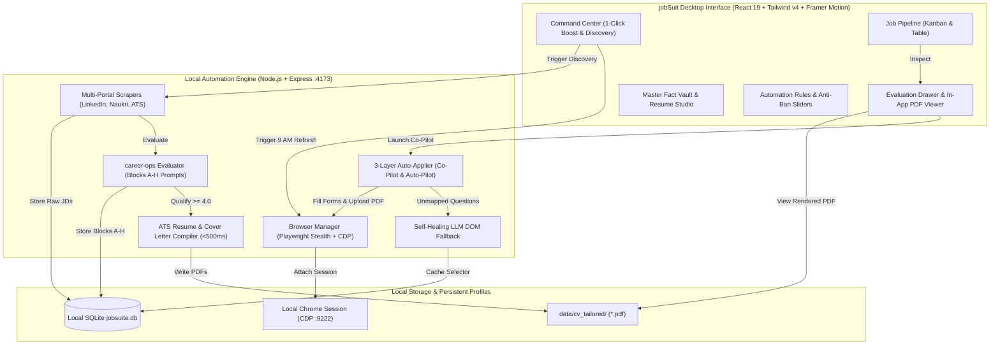

# jobSuit

<div align="center">

**Windows Native AI Job Automation & Career-Ops Desktop Platform**

*Ultra-efficient, privacy-first desktop application automating discovery, structured evaluation, hallucination-free tailoring, daily profile boosting, and 1-click ATS application submission.*

[](https://microsoft.com/windows)
[](https://react.dev)
[](https://vitejs.dev)
[](https://tailwindcss.com)
[](https://playwright.dev)
[-003B57?style=flat-square&logo=sqlite)](https://sqlite.org)
[](https://tauri.app)

</div>

---

## 🌟 Highlights & Zero Command-Prompt Guarantee

- **Zero Terminal Interaction**: Run all operations—scraping, evaluation, PDF compilation, profile boosting, and applications—directly from the GUI with animated multi-stage progress bars and live logs.
- **Ported `career-ops` Architecture**: Full Blocks A through H evaluation rubric, Step 0 archetype matching, 2-pass evidence gating, and 22-signal Block G ghost-job detection.
- **Strict Grounding Rule**: Zero hallucinations. Bullets only rephrase, reorder, and emphasize verified Master CV facts.
- **Instant ATS PDF Engine**: Compiles tailored CVs and cover letters via headless Playwright in **<450ms** with an interactive in-app PDF previewer.
- **Persistent CDP Browser Sessions**: Connects to your logged-in Google Chrome session via Chrome DevTools Protocol (`--remote-debugging-port=9222`) to bypass Cloudflare, 2FA prompts, and bot flags.
- **Indian & Global Recruitment Support**: Native handling for CTC (INR Lakhs / LPA), Official Notice Period (Days), Last Working Day (LWD), buyout availability, and US/Global EEO disclosures.

---

## 🚀 1-Click Launch (Desktop User Experience)

No need to open PowerShell or cmd. Double-click either batch file:

```text
📁 jobSuit/
├── 📄 Launch-jobSuite-AppWindow.bat   <-- (Recommended) Native borderless app window
└── 📄 Launch-jobSuite.bat             <-- Opens in your default web browser
```

Both launchers automatically initialize the background SQLite Express engine on port `4173` and launch the frontend interface on port `5173`.

---

## 🏗️ Architecture & Data Flow



---

## 🧩 Core Modules

### 1. Master CV & Personal Fact Vault (Module A)
- **Indian Recruitment Vault**: Current CTC (LPA INR), Expected CTC, CTC Negotiable, Official Notice Period (Days), Last Working Day (LWD), and Buyout availability.
- **Global Recruitment Vault**: Country authorizations, visa sponsorship requirements, relocation willingness, and EEO disclosures.
- **Master Resume ATS Compiler**: Compiles your master resume to `data/cv_tailored/Master_Resume.pdf` via Playwright in **~380ms** with in-app PDF preview.

### 2. Naukri.com Daily Profile Booster ("The 9 AM Refresh") (Module B)
- Automates the daily profile activity trigger at 08:55 AM IST (+/- 15 minutes random jitter).
- **Execution Flow**:
  1. Attaches to persistent Chrome CDP session.
  2. Re-uploads the latest Master Resume PDF to refresh the *Profile Last Updated* timestamp.
  3. Performs a micro-update on the Resume Headline (e.g., toggling a trailing period `.`) to force Naukri's search algorithm to flag an active candidate update.
- **1-Click Control**: Run on-demand from the UI or arm the Windows Task Scheduler background hook in 1 click.

### 3. Multi-Portal Discovery & `career-ops` Evaluator (Module C)
- Scrapes **LinkedIn Easy Apply**, **Naukri.com Freshness Filter**, and direct ATS boards (**Greenhouse, Lever, Ashby, Workday**).
- **Blocks A–H Evaluator**:
  - **Block A**: Role Summary & Authorization fit.
  - **Block B**: Two-pass requirement matching with explicit vs. inferred evidence gating.
  - **Block C**: Strategic positioning and archetype classification.
  - **Block D**: Compensation and seniority calibration.
  - **Block E**: Grounded bullet personalization diffs (anchored strictly to Master CV).
  - **Block F**: Anticipated recruiter interview questions.
  - **Block G**: 22-signal Ghost-Job and legitimacy detector (Flags evergreen spam, agency dumps, and stale postings).
  - **Block H**: Tailored draft application answers for custom employer questions.
  - **1.0 to 5.0 Holistic Score**: Jobs scoring $\ge 4.0$ automatically qualify and proceed to tailoring.

### 4. Hallucination-Free CV & Cover Letter Generator (Module D)
- **Strict Grounding Rule**: Zero hallucinated skills, metrics, or employers.
- **Sub-500ms Compilation**: Clean semantic ATS HTML/CSS rendered to PDF via headless Playwright.
- **In-App PDF Viewer**: Embedded PDF document viewer directly in the job drawer with side-by-side diff cards vs your master resume.

### 5. 3-Layer Auto-Applier & ATS Form Engine (Module E)
- **Co-Pilot Mode**: The engine fills every question, attaches your tailored PDF resume, and pauses at the final review screen for your 1-click confirmation.
- **Auto-Pilot Mode**: Unattended end-to-end submission with human delays and rate limits.
- **Portal Adapters**:
  - **LinkedIn Easy Apply**: Multi-step modal navigation, custom question answering, and PDF attachment.
  - **Naukri Apply**: 1-click apply and Naukri chatbot drawer questionnaire auto-fill.
  - **Workday**: Handles `data-automation-id` selectors, work history repeatable blocks, and dropdowns.
  - **Greenhouse / Lever / Ashby**: Standard form injection.
- **Self-Healing DOM Fallback**: Unknown questions are extracted, resolved against the Fact Vault via LLM, and cached in SQLite `dom_selector_cache`.

---

## 🖥️ UI Tour & Views

| View | Screenshot / Features |
| :--- | :--- |
| **Command Center** | Live status of the Naukri Daily Refresher, 1-click "Run Discovery Scan" modal, 1-click "Boost Profile Now", 1-click "Launch Chrome CDP", and real-time funnel statistics. |
| **Job Pipeline** | Kanban & Table views across 6 stages (`Discovered` → `Evaluated` → `CV Tailored` → `Ready to Apply` → `Applied` → `Interview`). |
| **Evaluation Drawer** | Full `career-ops` Blocks A–H report, Block G legitimacy badge, embedded in-app PDF document viewer, bullet diff cards, and 1-click Co-Pilot applier. |
| **Master Vault & Studio** | Visual editor for Indian & Global recruitment fields (CTC, notice period, EEO), work experience impact bullets, and live in-app Master ATS PDF preview. |
| **Automation Rules** | Daily application quotas, human delay sliders (8–25s), company & keyword blacklists, and platform Co-Pilot toggles. |
| **Settings & BYOK** | LLM API keys (Gemini, Claude, OpenAI, Ollama), 1-click Chrome CDP launcher, and 1-click Windows Task Scheduler arming. |

---

## 🛠️ Developer Setup & Manual Build

If you want to run the project from source or compile the Tauri binary:

### Prerequisites
- Node.js 20+ (Node.js 24 recommended)
- Google Chrome or Microsoft Edge
- *(Optional)* Rust & Cargo (for compiling standalone Tauri v2 executable)

### Installation
```bash
# Clone the repository
git clone https://github.com/crazingineer/jobSuit.git
cd jobSuit

# Install dependencies
npm install

# Initialize local SQLite database
npm run db:init

# Start development servers (Express Engine + Vite React UI)
npm run dev
```

### Production Build
```bash
# Build frontend assets
npm run build

# Build standalone Windows Tauri executable (if Rust is installed)
npm run tauri build
```

---

## 🔒 Security & Privacy

- **100% Local Storage**: All job listings, evaluations, resumes, and answers are stored locally in your SQLite database (`data/jobsuite.db`).
- **No Third-Party Cloud Dependency**: Your browser profile, cookies, and tokens never leave your local machine.
- **BYOK (Bring Your Own Key)**: Directly use your own Gemini, Anthropic, OpenAI, or local Ollama endpoints.

---

## 📜 License
MIT License. Built with love for job seekers and career-ops engineers.
